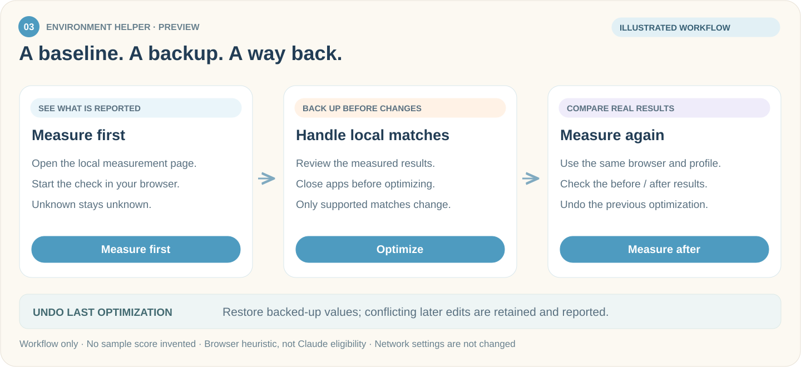
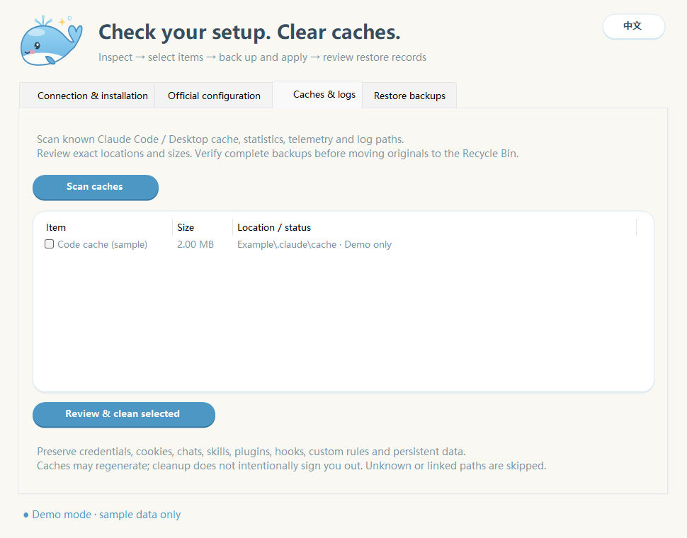
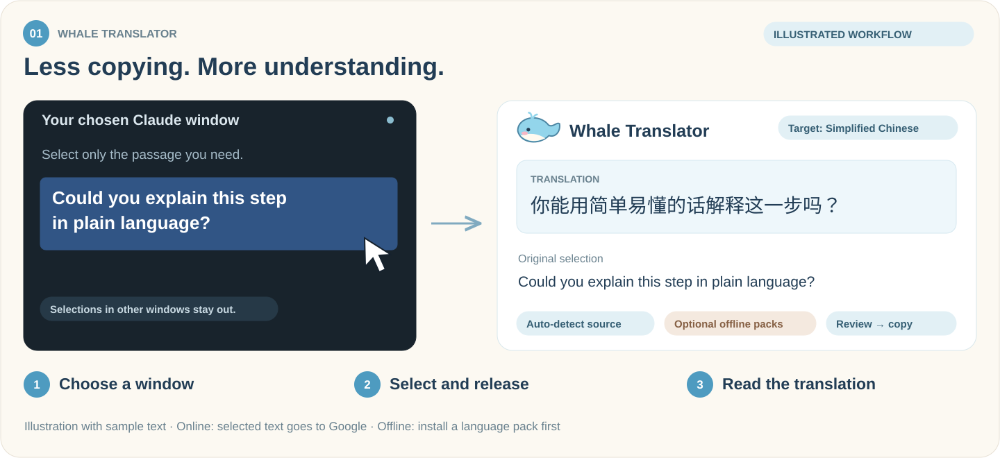
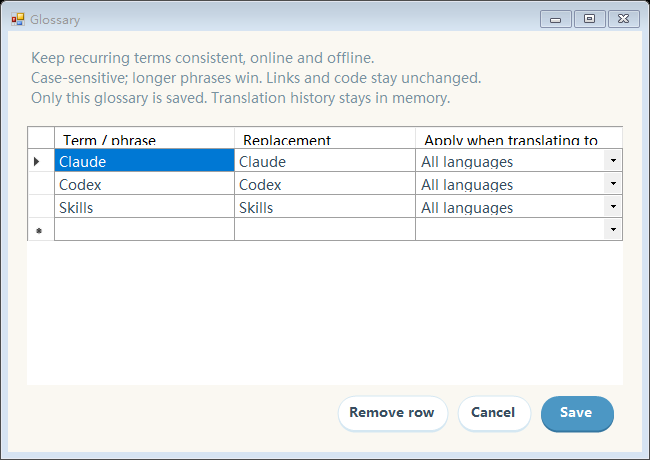
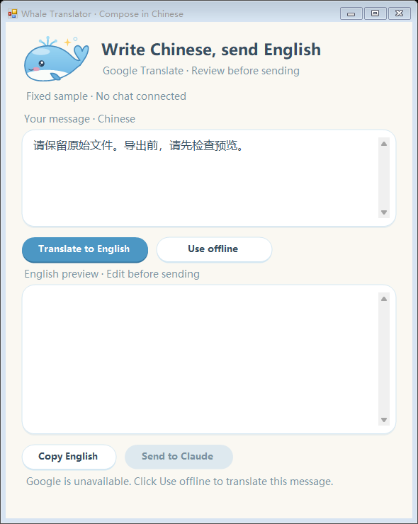
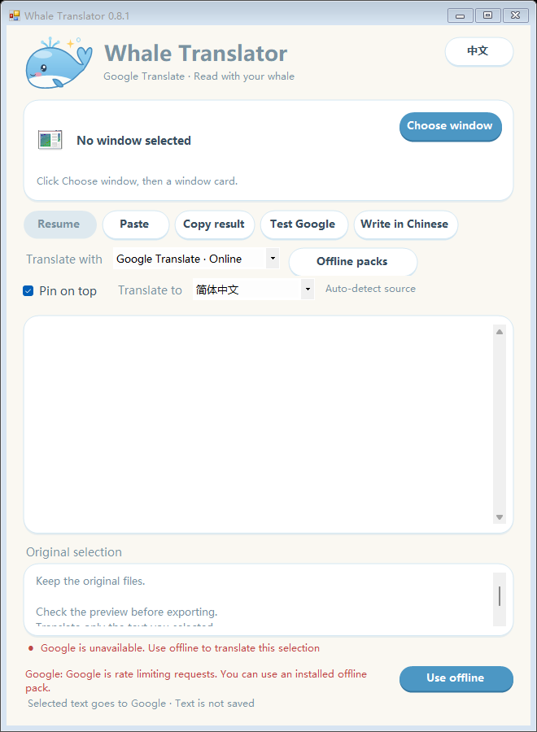
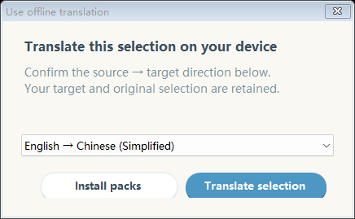
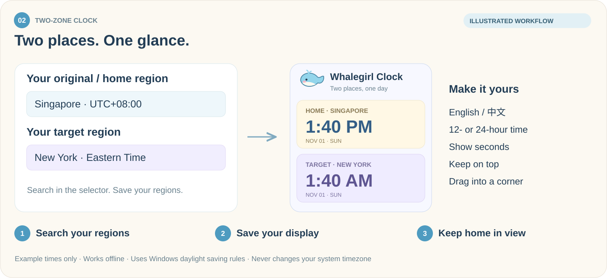
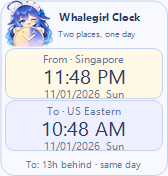

  

<h1 align="center">I Must Use Claude</h1>

<strong>Understand your local setup. Read Claude comfortably. Keep your home time in view.</strong>

我一定要用上Claude · Four whale-themed Windows companions, built around using Claude.

  
  
  
  

<strong>English</strong> · <a href="README.zh-CN.md">简体中文</a>

  <a href="https://github.com/whitecarp/I-Must-Use-Claude/releases/tag/v0.4.0-preview"><strong>↓ Download the apps</strong></a>
  &nbsp; · &nbsp; <a href="#choose-your-companion">Explore the tools</a>
  &nbsp; · &nbsp; <a href="docs/BUILDING.md">Build from source</a>

---

## Choose your companion

| Check your setup | Understand her replies | Know what time it is at home |
| :--- | :--- | :--- |
| **Whale Environment Helper** | **Whale Translator** | **Two-Zone Clock** |
| Measure browser signals, handle matched local settings, and measure again. | Translate Claude's replies and prepare English prompts from Chinese. | Keep your original timezone visible when your computer uses another one. |
| [Get Helper ↓](https://github.com/whitecarp/I-Must-Use-Claude/releases/download/v0.4.0-preview/WhaleEnvironmentHelper.exe) | [Get Translator ↓](https://github.com/whitecarp/I-Must-Use-Claude/releases/download/v0.3.0-preview/WhaleTranslator.exe) | [Get Clock ↓](https://github.com/whitecarp/I-Must-Use-Claude/releases/download/v0.3.0-preview/HomeTimeClock.exe) |

**Also new: [Whale Pack Helper 0.1.0](#04--prepare-a-clear-handoff)** prepares local handoff files for Claude.

**Download an EXE and double-click it.** Each app runs separately; install only what you need. The translator includes its runtime, while offline language packs are optional downloads inside the app. Source code remains public for developers.

<strong>Requirements, versions and language settings</strong>

- Windows 10/11. The translator's portable runtime requires **x64**; the desktop apps use **.NET Framework 4.8**.
- This update provides Environment Helper **0.7.0** and Pack Helper **0.1.0**. Translator **0.9.0** and Two-Zone Clock **0.3.0** keep their existing v0.3.0-preview downloads.
- Download the Windows EXEs. Pack Helper also requires its matching `.exe.config` beside the EXE; its ZIP includes both. GitHub's automatic source archives are for development, not the ready-to-run apps.
- This repository opens in English and also has a Chinese README. App language defaults are unchanged; the apps support English / 中文 switching.

### Keep the apps up to date

Environment Helper, Translator and Clock have a manual update check. Pack Helper 0.1.0 does not yet include this feature. It shows the available version from this repository's public GitHub releases, including previews, and lets you save the matching EXE to a location you choose.

<strong>How update downloads work</strong>

- Checks and downloads run only when you request them; there is no background update check.
- The download must match the SHA-256 digest supplied by GitHub for that release asset. A missing digest or a mismatch stops the download from being accepted as verified.
- The app does not replace itself or run the new EXE. Your existing app and settings stay in place; you decide when to switch.
- Update checking requires an internet connection. Translation offline mode and clock time display still work without it.

## 01 · Measure first, then adjust

### Whale Environment Helper · 大肥鱼环境助手

See what the browser actually reports before changing settings. Keep a baseline, handle supported matches with backups, then check the result rather than assuming the score improved.

Static workflow illustration for the preview version, not a measured result.

**Start in three steps**

1. Open **WhaleEnvironmentHelper.exe** and choose **Measure first**. In the local page opened by your default browser, click **Start measurement**.
2. Review the results. Save your work, close Claude, Chrome and Edge, then choose **Optimize** to process supported local matches.
3. Choose **Measure after** using the same browser and profile. Review the before/after results, or use **Undo last optimization** to restore the previous settings.

**Measured baseline · Unknown means unknown · Backup before changes · Undo available**

### Network & DNS

Open **Network & DNS** to measure DNS resolvers inside the helper without opening a browser. Results describe the helper's HTTPS/default-proxy path; they do not establish that browser-specific DoH or every application is leak-free. Timeouts, cancellation and empty results stay explicit rather than being reported as safe.

CuteCloud DNS changes use a separate **preview → private backup → confirm and apply → recheck** flow, with conflict-aware undo. Browser WebRTC is an optional separate check. Existing maintenance, Codex proxy configuration, close-app controls and the dedicated helper icon remain available.

### Maintenance & cleanup

Open **Maintenance & cleanup** at the bottom of the helper. These checks and cleanup actions are separate from the browser score.

| Page | What you can do |
| --- | --- |
| **Connection & installation** | Check common installation paths and whether proxy variables are set. Optionally probe DNS and HTTPS on official Claude hosts; distinguish timeouts, restrictions and rate limits. |
| **Official configuration** | Inspect Claude Code endpoint, authentication and model overrides. Choose which overrides to remove, with a configuration backup first. |
| **Caches & logs** | Scan known cache/log locations, review sizes, select items, verify backups, then move originals to the Recycle Bin. |
| **Restore backups** | Restore configuration or cache backups. Keep conflicting later edits and newly recreated caches. |

<strong>Preview the cleanup page</strong>

Offscreen demo rendering with synthetic data. No real cache was scanned or cleaned.

Close Claude and Claude Code normally before cleanup, repair or restore. Chats, login data, cookies, skills, plugins, hooks, MCP settings, custom rules and local identity remain protected. Configuration repair removes **selected authentication overrides**, not stored official login data. Unknown paths and linked files are skipped. CC Switch / Cockpit provider takeover is not switched automatically.

**Preview status:** The 0.7.0 integration passed 1,668 isolated checks and its final build verification. Independent Windows VM end-to-end acceptance is still pending; fixture checks do not establish results for your browser or network. Those tests do not apply cleanup or configuration changes to a personal environment.

<strong>What optimization changes — and what it preserves</strong>

- Missing or failed checks remain **unknown**, not zero. Optimization requires recent results for the actionable local checks; settings that did not match are skipped.
- Matched timezone settings can be changed to **UTC**, matched Chrome/Edge language preferences to **English**, and verified matching personal fonts can be backed up and removed.
- A timezone change affects the whole computer. Removing a personal font may temporarily change how documents look.
- System fonts, Claude login, chats and credentials stay protected. **Optimize** does not alter network/proxy/DNS settings; Network & DNS and Codex proxy configuration are separate actions with their own review and confirmation.
- Changes are backed up before application. Undo retains conflicting later edits and reports them instead of overwriting them.
- Save work and close Claude, Chrome and Edge before either optimization or undo. Use the same browser and profile for before/after measurements.

<strong>What the score means and how measurement works</strong>

The score follows a third-party environment heuristic adapted from [LinXiaoTao/FuckClaude](https://github.com/LinXiaoTao/FuckClaude). It is **not** an official Claude eligibility score or a guarantee of access. The score measures the browser page, not Claude Desktop's embedded environment. Separate DNS/proxy tools address supported local settings; they do not guarantee network routing or account access.

The page is served locally. Its disclosed WebRTC check contacts Google STUN; the result contains candidate counts, not raw IP addresses. Configuration backups remain local and may contain private browser data. Do not upload backups, credentials, diagnostic folders or personal documents to this repository.

## 02 · Read Claude in your language

### Whale Translator · 大肥鱼翻译

Understand Claude's replies without changing the way you work. Choose the Claude window, highlight a passage, and read the original and translation together.

Static feature illustration with sample text, not a software screenshot.

**Start in three steps**

1. Open **WhaleTranslator.exe** and choose Claude from the window cards.
2. Choose your target language. In Claude, hold the left mouse button, select text, and release.
3. Read or copy the translation. Use **Write in Chinese** when you want to write in Chinese and review an English version before sending.

**Automatic language detection · Optional offline packs · Personal glossary · Session history**

Open **Glossary** to save preferred terms for names and phrases. Use **Previous / Next** to revisit translations from the current session when a new selection replaces the result you were reading.

Rendered offscreen using sample entries; no personal dictionary or conversation was read.

<strong>Glossary, recent translations and offline use</strong>

- Google online mode detects the source language and supports 17 target languages. Only selections in the chosen window are translated; selections elsewhere are ignored.
- Glossary entries can apply to one target language or all languages, online and offline. Matching is case-sensitive; longer phrases take priority. Links and code keep their original text.
- Recent translations hold up to 20 successful results within a bounded memory budget. Closing the app clears them; glossary entries remain saved locally.
- You can pause selection translation, paste text manually, copy a translation, or pin the window on top.
- The Chinese prompt window lets you review English before explicitly sending. If direct sending is unsupported, copy and paste instead. Translation does not automatically send a message to Claude.
- Download offline language packs while online. Each pack covers one direction, such as English → Chinese; the reverse direction is separate.
- When Google is rate-limiting or requesting verification, **Use offline** can retry the current text with a compatible installed pack. Offline mode does not silently switch online.
- Images and scanned documents are not OCR-translated. Selection depends on the source app's copy behavior.

<strong>App previews: English prompts and offline retry</strong>

<strong>Review an English prompt before sending</strong>

<strong>Retry with an installed offline language pack</strong>

Existing demonstration screenshots with sample text.

<strong>Translation privacy and availability</strong>

Online mode sends selected text to Google Translate's key-free web endpoint. This is not Gemini or the paid Google Cloud Translation API; the endpoint can change, fail or rate-limit requests. Offline translation stays on your device. Language packages download only when you request them. Translation history stays in memory for the current session and is cleared when the app closes; it is not written to a history file. Your saved glossary is separate from translation history.

Offline quality depends on the package. Download the required directions and check them on the intended computer before travelling. Moving the EXE to a new computer does not copy installed models.

## 03 · Keep your home time close

### Two-Zone Clock · 两地时钟

Your computer may use another timezone. Your daily life does not have to. Keep your **original/home region** above your **target region**, in a small whale-themed desktop panel.

Static feature illustration with example times, not a software screenshot.

**Start in three steps**

1. Open **HomeTimeClock.exe**. Right-click the clock or tray icon and open region settings.
2. Search directly in each selector. Choose a fixed **home region** and your **target region**, then save.
3. Place the clock where you like. Your home time remains visible even if the computer timezone changes.

**Searchable regions · Compact vertical layout · Time difference and day hints · Offline clock**

With both regions visible, see how far your target region is ahead or behind home, plus the relative day: yesterday, the same day, tomorrow, or a larger day difference. Daylight saving changes are included.

<strong>Existing app preview and display options</strong>

Offscreen preview from the compiled clock, with synthetic times and regions.

- Search with English or Chinese names. Each region shows its time and date.
- Choose 12/24-hour time, seconds, one or two clocks, always-on-top, and a locked position.
- Drag the panel or return it to the lower-right corner. Settings persist between launches.
- Daylight saving changes follow Windows timezone rules; accuracy depends on the Windows clock and those rules.
- The app does **not** modify system time or timezone or check an account. Time display works offline; only a manually requested update check or download contacts GitHub.
- Choose a fixed home region rather than **Follow computer timezone** to keep home time independent of system changes.

---

## 04 · Prepare a clear handoff

### Whale Pack Helper · 大肥鱼打包助手

Package selected source files, images and video locally before handing them to Claude. Review the file list, optionally add handoff notes, and keep the originals intact. Each output file is capped at **29,000,000 bytes**. Source filtering excludes common build/runtime folders and suspected secrets; review the result before sharing it.

The app does not upload files or contact an AI service. Ordinary packaging and PNG/JPEG/BMP processing use built-in components; video compression and WebP decoding need an existing local **FFmpeg**.

[Download EXE](https://github.com/whitecarp/I-Must-Use-Claude/releases/download/v0.4.0-preview/WhalePackHelper.exe) · [Required matching config](https://github.com/whitecarp/I-Must-Use-Claude/releases/download/v0.4.0-preview/WhalePackHelper.exe.config) · [Download both as ZIP](https://github.com/whitecarp/I-Must-Use-Claude/releases/download/v0.4.0-preview/WhalePackHelper-0.1.0.zip)

Keep `WhalePackHelper.exe.config` beside `WhalePackHelper.exe`. [Source and usage](apps/whale-pack-helper/README.md) include the build script, resources and tests.

---

## Other useful tools

[Cockpit Tools](https://github.com/jlcodes99/cockpit-tools) is an independent third-party desktop app for account switching and quota viewing in supported clients; check its [releases](https://github.com/jlcodes99/cockpit-tools/releases) for current Claude support. Its API or gateway access is separate from a Claude subscription. This repository does not bundle Cockpit Tools.

## Explore the source

| Project | Source | Further reading |
| --- | --- | --- |
| Environment Helper | [apps/whale-claude-helper](apps/whale-claude-helper/) | [Build instructions](docs/BUILDING.md) |
| Translator | [apps/claude-live-translator](apps/claude-live-translator/) | [Release notes](RELEASE_NOTES.md) |
| Clock | [apps/two-zone-clock](apps/two-zone-clock/) | [Third-party notices](THIRD_PARTY_NOTICES.md) |
| Pack Helper | [apps/whale-pack-helper](apps/whale-pack-helper/) | [Usage and dependencies](apps/whale-pack-helper/README.md) |

Offline translation uses CTranslate2 and SentencePiece with optional packages from the Argos catalog. Upstream licenses and attribution are retained in the [third-party notices](THIRD_PARTY_NOTICES.md).

An independent community companion project. Not affiliated with or endorsed by Anthropic or Google.

