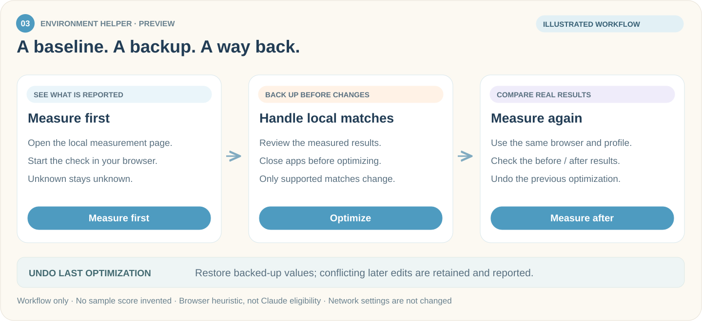
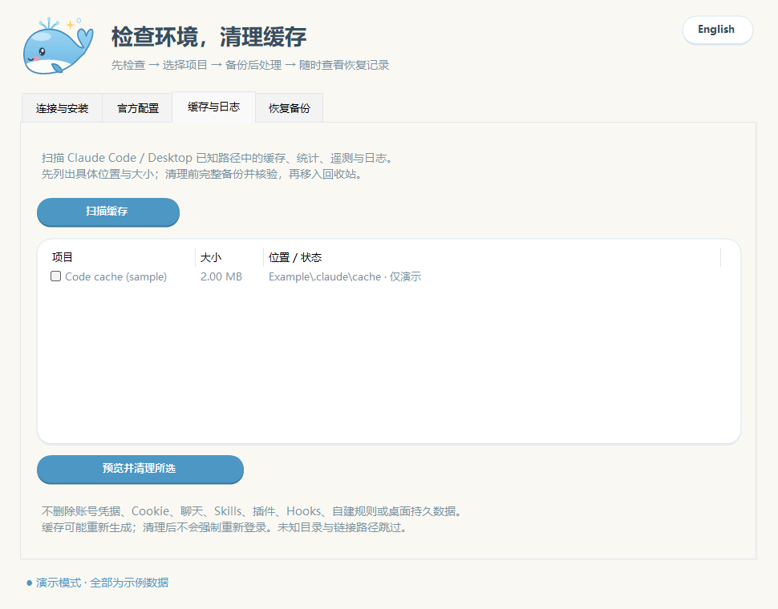
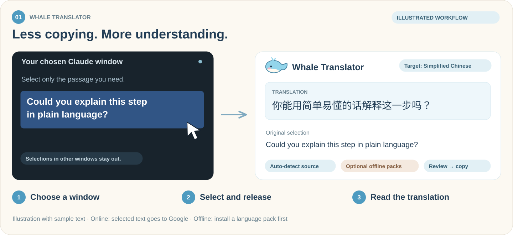
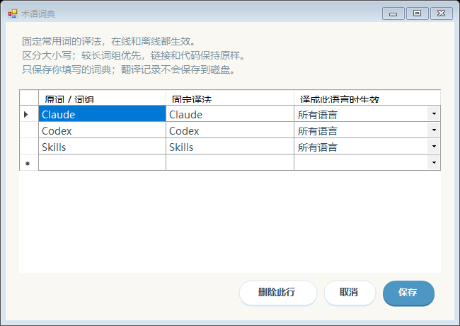
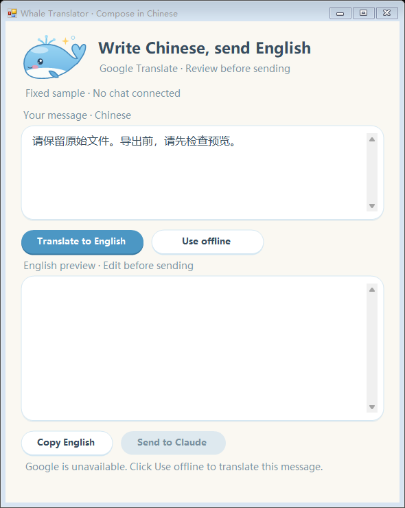
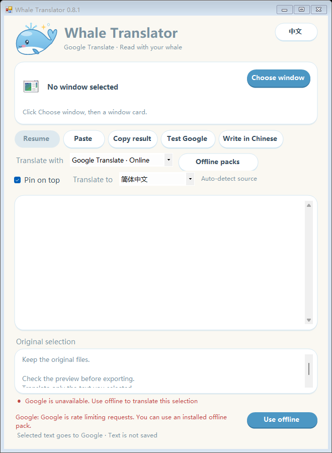
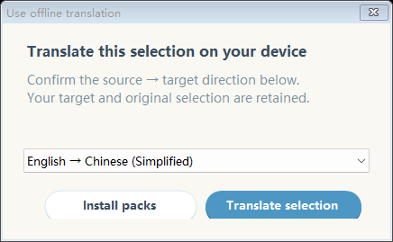
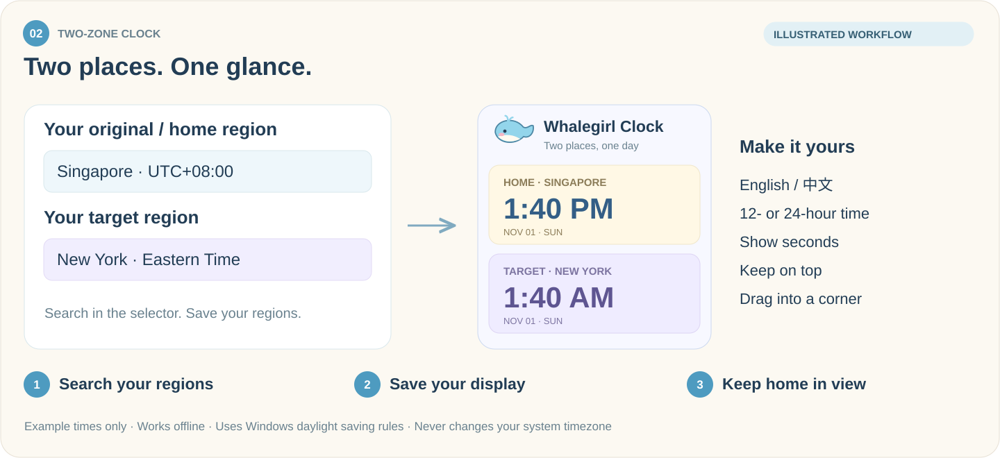

<p align="center">
  
</p>

<h1 align="center">我一定要用上Claude</h1>
<p align="center"><strong>了解使用环境，看懂 Claude 的回复，记住自己那边几点。</strong></p>
<p align="center">I Must Use Claude · 围绕 Claude 使用体验制作的四款鲸鱼主题 Windows 工具。</p>

<p align="center">
  
  
  
  
</p>

<p align="center"><a href="README.md">English</a> · <strong>简体中文</strong></p>
<p align="center">
  <a href="https://github.com/whitecarp/I-Must-Use-Claude/releases/tag/v0.4.1-preview"><strong>↓ 下载软件</strong></a>
  &nbsp; · &nbsp; <a href="#选一个陪你用-claude-的工具">认识工具</a>
  &nbsp; · &nbsp; <a href="https://whitecarp.github.io/I-Must-Use-Claude/">项目主页</a>
  &nbsp; · &nbsp; <a href="docs/BUILDING.md">从源码构建</a>
</p>

---

## 选一个陪你用 Claude 的工具

| 了解当前使用环境 | 看懂她的回复 | 知道自己那边几点 | 整理给她的文件 |
| :--- | :--- | :--- | :--- |
| **大肥鱼环境助手** | **大肥鱼翻译** | **两地时钟** | **大肥鱼打包助手** |
| 先测浏览器环境，再处理命中的本地设置，最后复测。 | 翻译 Claude 的回复，也能把中文问题准备成英文。 | 即使电脑用了其他时区，也能看到原本地区的时间。 | 在本机整理源码、图片和视频，每个文件不超过 29 MB。 |
| [下载环境助手 ↓](https://github.com/whitecarp/I-Must-Use-Claude/releases/download/v0.4.1-preview/WhaleEnvironmentHelper.exe) | [下载翻译器 ↓](https://github.com/whitecarp/I-Must-Use-Claude/releases/download/v0.4.1-preview/WhaleTranslator.exe) | [下载时钟 ↓](https://github.com/whitecarp/I-Must-Use-Claude/releases/download/v0.4.1-preview/HomeTimeClock.exe) | [下载打包助手 ↓](https://github.com/whitecarp/I-Must-Use-Claude/releases/download/v0.4.1-preview/WhalePackHelper.exe) |

**下载 EXE，双击打开。** 各个软件独立运行，用哪个下哪个。翻译器自带运行库，离线语言包在软件里按需选装。源码仍公开，方便开发者查看。

<details>
<summary><strong>运行要求、版本与语言设置</strong></summary>

- 适用于 Windows 10/11。翻译器便携运行库需要 **x64**；桌面程序使用 **.NET Framework 4.8**。
- **v0.4.1-preview** 同时提供四个 EXE：环境助手 **0.7.0**、翻译器 **0.9.1**、两地时钟 **0.3.0**、打包助手 **0.1.1**。
- 提供 Windows EXE；打包助手 0.1.1 无需旁置配置文件或 ZIP。GitHub 自动生成的源码压缩包面向开发者，不是开箱即用的软件。
- GitHub 默认展示英文，并提供这份中文说明。软件自身默认语言保持现状，支持 English / 中文切换。

</details>

<details>
<summary><strong>第一次打开时 Windows 提示“已保护你的电脑”</strong></summary>

本轮仍是**未签名预览版**，Windows SmartScreen 可能会拦下第一次运行；请阅读[代码签名政策和当前状态](docs/CODE_SIGNING.md)。SHA-256 一致只能核对文件完整性，不代表已认证发布者身份。先核对文件，再决定是否运行：

1. 在下载 EXE 的文件夹里打开 PowerShell，运行下面的命令（文件名换成你下载的那个）：

   ```powershell
   Get-FileHash .\WhaleEnvironmentHelper.exe -Algorithm SHA256
   ```

2. 把输出的值和 [本版 SHA-256 校验值](https://github.com/whitecarp/I-Must-Use-Claude/releases/tag/v0.4.1-preview#sha-256) 里同名文件的值对比，一致才说明文件没有被改动。
3. 一致后，在 SmartScreen 窗口点「更多信息」→「仍要运行」。不一致就删掉文件，重新从本仓库的 Releases 下载。

</details>

### 在软件里检查更新

四个软件都提供手动更新检查。打包助手 0.1.1 在「设置 → 检查更新」中操作。点击后会查看本仓库的 GitHub 公开发布（包含预览版），显示可用版本，并让你选择位置保存对应软件的 EXE。

<details>
<summary><strong>更新下载如何工作</strong></summary>

- 只有主动操作才会检查或下载，不在后台自动检查更新。
- 下载文件必须与 GitHub 为该发布文件提供的 SHA-256 校验值一致；缺少校验值或核验不一致时，不会把文件作为已验证的更新交付。
- 软件不会自行替换或运行新版 EXE。旧软件和设置保留，何时切换由你决定。
- 检查更新需要联网；翻译器离线模式和时钟显示时间仍可离线使用。

</details>

## 01 · 先测清楚，再动设置

### 大肥鱼环境助手 · Whale Environment Helper

先看浏览器实际报告了什么，再决定哪些设置值得调整。保留检测基准，先备份再处理，最后用复测结果确认变化。

<p align="center"></p>
<p align="center"><sub>预览版工作流程示意图，并非实测结果。</sub></p>

**三步开始**

1. 打开 **WhaleEnvironmentHelper.exe**，点击「开始检测」，在默认浏览器打开的本机页面里点击「开始测量」。
2. 查看结果，保存工作并退出 Claude、Chrome、Edge，再点击「一键优化」，处理受支持的本地命中项。
3. 用相同浏览器和个人资料点击「复测结果」，查看实际前后变化；想恢复时使用「撤回上次优化」。

**实测基准 · 未知不算零分 · 修改前备份 · 提供撤回**

### 网络与 DNS

打开「网络与 DNS」，可直接在助手内测量 DNS 解析器，无需打开浏览器。结果描述助手 HTTPS／默认代理这条路径，不代表浏览器独立 DoH 或所有应用均无泄露。超时、取消和空结果会明确显示，不会当成安全结果。

CuteCloud DNS 修改使用独立的「预览 → 私密备份 → 确认应用 → 重新检测」流程，并支持保留后续冲突修改的撤回。浏览器 WebRTC 是单独可选检测。已有的维护清理、Codex 代理配置、关闭程序入口和环境助手专属图标继续保留。

### 维护与清理

在环境助手底部打开「维护与清理」。这些检查与清理操作独立于浏览器评分。

| 页面 | 可以做什么 |
| --- | --- |
| **连接与安装** | 检查常见安装位置、代理变量是否设置；可选择探测 Claude 官方域名的 DNS 和 HTTPS，区分超时、访问受限与限流。 |
| **官方配置** | 检查 Claude Code 的地址、认证和模型覆盖项，勾选需要移除的项目，先备份再处理。 |
| **缓存与日志** | 扫描已知缓存与日志位置，查看大小、勾选项目、核验备份后移入回收站。 |
| **恢复备份** | 恢复配置或缓存备份，保留发生冲突的后续修改及新生成的缓存。 |

<details>
<summary><strong>查看清理页面预览</strong></summary>

<p align="center"></p>

模拟数据离屏渲染，没有扫描或清理真实缓存。

</details>

清理、修复或恢复前，请正常退出 Claude 和 Claude Code。会话、官方登录数据、Cookie、Skills、插件、Hooks、MCP、自建规则及本地身份标识受到保护。配置修复移除的是**选中的认证覆盖项**，不删除官方登录数据。未知路径与链接文件会跳过；不会自动切换 CC Switch / Cockpit 的供应商接管。

**预览状态：** 源码 `5959687` 的[云端 Windows 验收已通过](https://github.com/whitecarp/I-Must-Use-Claude/actions/runs/41398526505)：49 项流程检查、11 项时区检查，以及四款软件的窗口截图。修改与撤回只在 GitHub 临时 Windows 虚拟机和临时测试数据上执行，没有操作个人电脑；不代表真实 Claude 账号、个人浏览器／网络、在线更新下载或真实素材端到端验证。后续源码变更仍需对应的新一轮通过记录。

<details>
<summary><strong>优化会改什么，保留什么</strong></summary>

- 缺失或失败项目显示**未知**，不算 0 分。只有可处理本地项目有近期有效结果时才能优化；未命中的设置跳过。
- 命中时可将时区设为 **UTC**、将被测 Chrome/Edge 的语言偏好设为**英语**，以及备份移除确切匹配的个人字体。
- 时区修改影响整台电脑；移除个人字体可能使文档临时使用替代字体。
- 系统字体、Claude 登录、聊天与凭据受保护。「一键优化」不改网络、代理或 DNS；「网络与 DNS」和 Codex 代理配置是另行查看与确认的独立操作。
- 修改前备份。撤回遇到后续独立修改时会保留新内容并提示冲突，避免直接覆盖。
- 优化或撤回前请保存工作并正常退出 Claude、Chrome 和 Edge；前后检测使用相同浏览器和个人资料。

</details>

<details>
<summary><strong>分数含义与检测数据</strong></summary>

评分参考 [LinXiaoTao/FuckClaude](https://github.com/LinXiaoTao/FuckClaude) 的环境启发式规则，**不是 Claude 官方账号资格评分，也不保证解除访问限制**。评分检测的是浏览器页面，不是 Claude Desktop 内嵌环境。独立的 DNS／代理工具只处理受支持的本地设置，不保证网络路线畅通或账号可用。

测量页在本机提供。其中事先说明的 WebRTC 检查会联系 Google STUN，只回传候选数量，不回传原始 IP。配置备份留在本机，可能包含私人浏览器数据。请勿把备份、凭据、诊断目录或私人文件上传到仓库。

</details>

## 02 · 用你熟悉的语言读 Claude

### 大肥鱼翻译 · Whale Translator

选择 Claude 窗口，划选一段想读的回复，在旁边对照原文和译文。继续和她交流，不用被语言打断。

<p align="center"></p>
<p align="center"><sub>静态功能示意图，文字为示例内容，并非软件实测截图。</sub></p>

**三步开始**

1. 打开 **WhaleTranslator.exe**，在窗口卡片里选择 Claude。
2. 选好目标语言，到 Claude 里按住鼠标左键划选文字，松开。
3. 阅读或复制译文；需要中文提问时，打开「中文提问」，预览英文后再主动发送。

**自动识别原文 · 可选离线包 · 个人术语表 · 本次翻译记录**

打开「术语词典」，保存名字和常用词的偏好译法。划选了新内容后，还能用「上一条／下一条」回看本次打开期间的译文，不怕刚才那段被替换。

<p align="center"></p>
<p align="center"><sub>使用示例词条离屏渲染；未读取个人词典或会话。</sub></p>

<details>
<summary><strong>术语词典、近期译文与离线使用</strong></summary>

- Google 在线模式自动识别原文，支持 17 种目标语言；只处理所选窗口中的划选，忽略其他窗口。
- 术语可按目标语言或所有语言生效，支持在线和离线翻译。匹配区分大小写，较长词组优先；链接和代码保留原样。
- 近期译文在有限内存中最多保留 20 条成功结果；关闭软件后清空，术语词典则单独保存在本机。
- 可以暂停划选、手动粘贴、复制译文，或把窗口置顶。
- 「中文提问」允许先预览英文，再主动发送。不支持直接发送时可复制后手动粘贴；翻译完成不会自动给 Claude 发消息。
- 有网时下载需要的离线语言包。每个包对应一个方向，例如英文 → 中文；反向需要另装。
- Google 限流或要求验证时，「改用离线翻译」可以用兼容的已安装语言包重译当前文字。离线模式不会悄悄切回联网。
- 图片和扫描件不做 OCR。划选内容取决于原应用的复制行为。

</details>

<details>
<summary><strong>界面预览：中文提问与离线重译</strong></summary>

<p align="center"><strong>先预览英文，再主动发送</strong></p>
<p align="center"></p>

<p align="center"><strong>选择已安装的语言包，继续离线重译</strong></p>
<p align="center"></p>
<p align="center"></p>

既有演示截图，文字为示例内容。

</details>

<details>
<summary><strong>翻译隐私与可用性</strong></summary>

在线模式会把所选文字发给 Google Translate 的免密钥网页接口。这不是 Gemini 或付费 Google Cloud Translation API，接口可能变化、失败或限流。离线翻译在本机完成；语言包仅在用户操作时下载。翻译记录只保留在本次运行的内存中，关闭软件即清空，不写入历史文件；用户保存的术语表与翻译记录分开。

离线质量取决于语言包。出行前请联网下载需要的方向，并在目标电脑上检查。把 EXE 复制到新电脑不会同时复制已安装的模型。

</details>

## 03 · 电脑时区变了，家里的时间还在

### 两地时钟 · Two-Zone Clock

上方是**原本地区**，下方是**目标地区**。小小的鲸鱼时钟陪在桌面，让你随时知道自己那边现在几点。

<p align="center"></p>
<p align="center"><sub>静态功能示意图，其中时间仅作示例，不是当前实时时间。</sub></p>

**三步开始**

1. 打开 **HomeTimeClock.exe**，右键时钟或托盘图标，进入地区设置。
2. 直接在两个选择框里搜索，选定固定的**原本地区**和**目标地区**，保存。
3. 把时钟放在方便看的位置。以后电脑时区变化，你原本地区的时间依然清楚。

**地区直接搜索 · 小巧上下排列 · 时差与跨日提示 · 离线计时**

同时显示两个地区时，可以直接看出目标地区比原本地区快或慢多久，以及昨天、同一天、明天或更大的跨日差。显示的时差会考虑夏令时。

<details>
<summary><strong>既有界面预览、显示选项与时区行为</strong></summary>

<p align="center"></p>

用编译后的时钟离屏生成，时间和地区为模拟示例。

- 支持中英文搜索；每个地区显示各自的时间和日期。
- 可选 12/24 小时制、秒数、单/双时钟、置顶与锁定位置。
- 面板可以拖动，也能放回屏幕右下角；重新打开后保留设置。
- 夏令时跟随 Windows 时区规则；准确度取决于 Windows 系统时钟及规则。
- 软件**不修改电脑时间或时区**，不读取账号。显示时间不需要联网；只有主动检查或下载更新时才会访问 GitHub。
- 想让原本地区不随系统变化，请选固定地区，而不是「跟随电脑时区」。

</details>

---

## 04 · 整理给 Claude 的交接文件

### 大肥鱼打包助手 · Whale Pack Helper

在本机选择源码、图片或视频，查看文件清单，可选填写交接说明，再生成打包结果。原文件保持不变，每个输出文件不超过 **29,000,000 字节**。源码过滤会跳过常见构建／运行库目录和疑似密钥；分享前仍需检查结果。

本地打包不上传文件、不连接 AI 服务；只有用户主动检查或下载更新时才会访问 GitHub。普通打包和 PNG/JPEG/BMP 处理使用自带组件；视频压缩和 WebP 解码需要本机已有 **FFmpeg**。

[下载打包助手 0.1.1 EXE](https://github.com/whitecarp/I-Must-Use-Claude/releases/download/v0.4.1-preview/WhalePackHelper.exe)

单个 EXE，无需旁置配置文件或 ZIP。[源码和使用说明](apps/whale-pack-helper/README.md) 包含编译脚本、素材与测试。

---

## 其他配套工具

[Cockpit Tools](https://github.com/jlcodes99/cockpit-tools) 是独立的第三方桌面工具，可为其支持的客户端切换账号、查看额度；Claude 相关功能请以[项目最新发布](https://github.com/jlcodes99/cockpit-tools/releases)为准。它提供的 API 或网关接入与 Claude 官方订阅不同。本仓库不捆绑 Cockpit Tools。

## 查看源码

| 项目 | 源码 | 更多说明 |
| --- | --- | --- |
| 环境助手 | [apps/whale-claude-helper](apps/whale-claude-helper/) | [构建说明](docs/BUILDING.md) |
| 翻译器 | [apps/claude-live-translator](apps/claude-live-translator/) | [发布说明](RELEASE_NOTES.md) |
| 时钟 | [apps/two-zone-clock](apps/two-zone-clock/) | [第三方声明](THIRD_PARTY_NOTICES.md) |
| 打包助手 | [apps/whale-pack-helper](apps/whale-pack-helper/) | [用法与依赖](apps/whale-pack-helper/README.md) |

离线翻译使用 CTranslate2、SentencePiece 和用户选装的 Argos 目录语言包。上游许可和署名保留于[第三方声明](THIRD_PARTY_NOTICES.md)。

## 安全、隐私与签名

请阅读[隐私说明](docs/PRIVACY.md)、[安全问题报告方式](SECURITY.md)和[代码签名政策](docs/CODE_SIGNING.md)。在线翻译会把所选文字发送给 Google；离线翻译和本地打包在设备上完成；手动检查和下载更新会联系 GitHub。

## 许可证

本仓库自己的代码以 [MIT 许可证](LICENSE)发布。第三方组件和语言包保留各自的许可证，见[第三方声明](THIRD_PARTY_NOTICES.md)。

<p align="center"><sub>独立社区辅助项目，不隶属于 Anthropic 或 Google，也未获得其背书。</sub></p>
